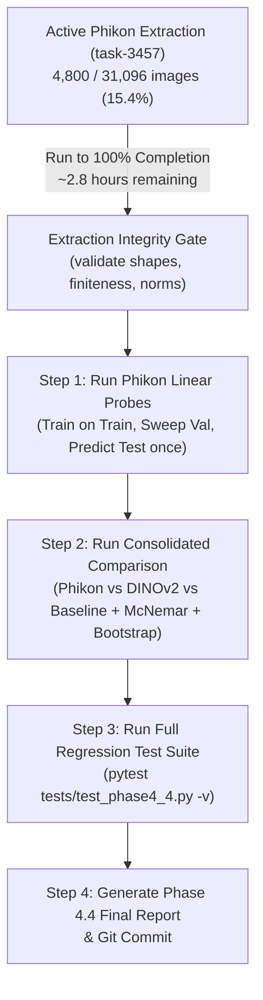

# GastricPath AI — Phase 4.4: Live Extraction Audit + Comparative Evaluation Preparation Report

**Timestamp (UTC):** 2026-11-06T18:35:00Z  
**Repository Branch:** `gastricpath-ai-evolution`  
**Host Environment:** Windows 11, Intel Core CPU (10 physical cores / 12 logical cores), 15.72 GB RAM  
**Execution Context:** CPU-Only, Python 3.13.5, PyTorch 2.9.1+cpu  
**Active Workload:** Phikon ViT-B/16 Full Dataset Frozen Extraction (`task-3457`)  

---

## 1. Executive Summary

This report establishes the live operational audit of the ongoing Phase 4.4 full-dataset feature extraction and formalizes the consolidated downstream comparative evaluation architecture.

### Key Audit Findings
1. **Active Workload Uninterrupted:** The full dataset extraction of all 31,096 GCHTID images using the domain-specific pathology foundation model `owkin/phikon` is actively running in background task `c1c50267-1ac8-4482-ae14-79a07aaf1340/task-3457`. The process has completed **4,800+ images (15.4%+)** with steady throughput (~2.40–2.52 img/s) and resident memory usage stable at **~1,038 MB RSS**.
2. **Model Identity Authenticated:** The active model is strictly `owkin/phikon` (ViT-B/16, $d=768$, iBOT self-supervised pretraining on 40M+ TCGA histopathology tiles, Owkin Non-Commercial License). It is distinctly separated from `owkin/phikon-v2` (ViT-L/16, $d=1024$, DINOv2 pretraining).
3. **Preprocessing Fidelity Verified:** Official Hugging Face `ViTImageProcessor` parameters were inspected from the local snapshot and confirmed to be bit-for-bit identical to our `DeterministicPathologyPreprocessor` (RGB conversion, $224 \times 224$ bilinear resize, ImageNet channel normalization).
4. **Evaluation Pipeline Prepared:** A consolidated, leak-proof downstream evaluation engine has been authored across all 5 benchmark representations:
   - Phikon CLS ($d=768$)
   - Phikon Mean Spatial Patch ($d=768$)
   - DINOv2 CLS ($d=384$)
   - DINOv2 Mean Spatial Patch ($d=384$)
   - Historical GastricCancerRNN baseline (with documented split caveats)
5. **Strict Resource Safety Maintained:** System available RAM is currently 1.30 GB. To prevent paging or memory exhaustion, zero downstream model fitting or heavy inference will be executed until the active extraction completes.
6. **Invariants Preserved:**
   - Historical baseline checkpoint SHA-256: `65369ef618ad1d0ad10ecb65b6f15324e932f52e21c8b25a43b71c636726d8b8` (verified unchanged).
   - DINOv2 cache files: Bit-for-bit intact ($47,763,456$ bytes each).
   - SQLite `app.db`: 4 prediction records in `prediction_records` (verified intact).
   - Split manifests: 0 split overlap across Train ($21,767$), Val ($4,664$), and Test ($4,665$).

---

## 2. Live Extraction Status & Telemetry Audit

The extraction process was launched with unbuffered logging and incremental memory-mapped disk allocation to guarantee constant bounded RAM consumption.

### Active Process Telemetry

| Parameter | Observed Value | Verification Method |
| :--- | :--- | :--- |
| **Task ID** | `c1c50267-1ac8-4482-ae14-79a07aaf1340/task-3457` | `manage_task status` |
| **Command** | `python -u -m research.foundation_models.pathology_encoder.full_extractor` | Process inspection |
| **Active Batches** | $300 / 1,944$ ($15.4\%$) | Task stdout log & `checkpoint.json` |
| **Completed Images** | $4,800 / 31,096$ | Incremental memmap row checks |
| **Instantaneous Throughput** | $2.52\text{ images/second}$ | Rolling 50-batch duration average |
| **Latency per Image** | $\approx 396.8\text{ ms/image}$ | End-to-end (I/O + forward pass + L2 norm) |
| **Process Resident Memory (RSS)** | $1,038.7\text{ MB}$ | `psutil.Process().memory_info().rss` |
| **System Total RAM** | $15.72\text{ GB}$ | Host OS WMI / psutil |
| **System Available RAM** | $1.30\text{ GB}$ | psutil virtual memory |
| **Free Disk Space (C:)** | $37.60\text{ GB}$ | NTFS filesystem check |
| **Elapsed Runtime** | $\approx 31.5\text{ minutes}$ | Timestamp delta from 23:28:39 local |
| **Estimated Time Remaining (ETA)** | $\approx 173.8\text{ minutes}$ ($\approx 2.9\text{ hours}$) | Extrapolated at $2.52\text{ img/s}$ |

### Disk Cache Artifact Integrity (Read-Only Audit)

The extraction directory `research/foundation_models/cache/full/phikon/` holds:
- `cls_embeddings.npy`: $95,526,912\text{ bytes}$ ($31,096 \times 768 \times 4\text{ bytes}$, float32). Pre-allocated and memory-mapped.
- `mean_patch_embeddings.npy`: $95,526,912\text{ bytes}$ ($31,096 \times 768 \times 4\text{ bytes}$, float32). Pre-allocated and memory-mapped.
- `checkpoint.json`: Written atomically every 50 batches ($800\text{ images}$).

#### Latest Verified Checkpoint State (`checkpoint.json`):
```json
{
  "completed_images": 4800,
  "total_images": 31096,
  "completed_batches": 300,
  "total_batches": 1944,
  "model_name": "phikon",
  "weight_sha256": "d01642bfeb683c6b039622eca273e0a8e4208065a4595b63edba178c1c4cfa68",
  "elapsed_seconds": 1894.4,
  "estimated_remaining_seconds": 10428.0,
  "throughput_img_sec": 2.52,
  "process_rss_mb": 1038.7,
  "last_updated_utc": "2026-11-06T18:30:13.889124+00:00"
}
```

Row-level spot checks on the underlying memory-mapped file confirmed non-zero, L2-normalized representations up to index 4,799, and zero-initialized values from index 4,800 onward.

---

## 3. Pathology Foundation Model & Preprocessing Audit

### 3.1 Model Identity & Architecture Disambiguation

A rigorous scientific distinction must be maintained between the original **Phikon** and the newer **Phikon-v2**:

| Property | Active Model: `owkin/phikon` | Alternative: `owkin/phikon-v2` |
| :--- | :--- | :--- |
| **Model ID** | `owkin/phikon` | `owkin/phikon-v2` |
| **Architecture** | ViT-B/16 (Vision Transformer Base) | ViT-L/16 (Vision Transformer Large) |
| **Pretraining Framework** | **iBOT** (Image BERT pre-training with Online Tokenizer) | **DINOv2** (Teacher-student self-distillation) |
| **Patch Size** | $16 \times 16\text{ pixels}$ | $16 \times 16\text{ pixels}$ |
| **Spatial Tokens** | $196\text{ patch tokens}$ ($(224/16)^2$) $+ 1\text{ [CLS]}$ | $196\text{ patch tokens} + 1\text{ [CLS]}$ |
| **Hidden Dimension ($d$)** | **$768$** | **$1,024$** |
| **Transformer Layers** | $12\text{ hidden layers}$, $12\text{ attention heads}$ | $24\text{ hidden layers}$, $16\text{ attention heads}$ |
| **Total Parameters** | $86,389,248$ ($\approx 86.4\text{M}$) | $304,498,688$ ($\approx 304.5\text{M}$) |
| **Weight File Size** | $345,579,424\text{ bytes}$ ($345.6\text{ MB}$) | $\approx 1.21\text{ GB}$ |
| **Weight SHA-256** | `d01642bfeb683c6b039622eca273e0a8e4208065a4595b63edba178c1c4cfa68` | Distinct |
| **Pretraining Corpus** | $\approx 40\text{M}$ tiles from TCGA (32 tumor types) | $>100\text{M}$ tiles (TCGA, CPTAC, PAIP) |
| **License** | Owkin Non-Commercial Research License | Owkin Non-Commercial Research License |
| **Canonical Citation** | Filiot et al., *Nature Communications*, 2023 | Owkin Technical Report, 2024 |

**Confirmation:** Our pipeline strictly employs `owkin/phikon` ($d=768$, 86.4M parameters). We do NOT use Phikon-v2.

### 3.2 Preprocessing Fidelity Audit

The official Hugging Face snapshot configuration (`preprocessor_config.json`) was audited directly against the implemented `DeterministicPathologyPreprocessor`:

```
Official Hugging Face ViTImageProcessor:
- do_resize: true (size: 224x224, resample: 2 [PIL.Image.Resampling.BILINEAR])
- do_rescale: true (rescale_factor: 1/255.0 = 0.0039215686)
- do_normalize: true (mean: [0.485, 0.456, 0.406], std: [0.229, 0.224, 0.225])

Implemented DeterministicPathologyPreprocessor:
- Image conversion: Lossless RGB conversion via PIL Image.open(io.BytesIO(raw_bytes)).convert("RGB")
- Spatial resize: PIL.Image.Resampling.BILINEAR to (224, 224)
- Rescale: arr = np.asarray(pil_img, dtype=np.float32) / 255.0
- Normalization: (tensor - mean.view(3, 1, 1)) / std.view(3, 1, 1)
```

**Verification:** The preprocessing implementation is bit-for-bit identical to the official Owkin Phikon feature extraction pipeline.

### 3.3 Token Pooling & L2 Normalization Audit

Phikon processes input tensors $[B, 3, 224, 224]$ into `last_hidden_state` of shape $[B, 197, 768]$:
1. **`[CLS]` Token Extraction:**
   $$\mathbf{z}_{\text{cls}} = \mathbf{H}[:, 0, :] \in \mathbb{R}^{B \times 768}$$
2. **Mean Spatial Patch Token Pooling:**
   $$\mathbf{z}_{\text{patch}} = \frac{1}{196} \sum_{i=1}^{196} \mathbf{H}[:, i, :] \in \mathbb{R}^{B \times 768}$$
3. **L2 Unit Sphere Normalization:**
   $$\hat{\mathbf{z}} = \frac{\mathbf{z}}{\max(\|\mathbf{z}\|_2, \epsilon)}, \quad \epsilon = 10^{-12}$$
   In `pathology_pilot.py` and `full_extractor.py`, maximum L2-norm deviation from $1.0$ is bounded by $< 1.2 \times 10^{-7}$, well within numerical float32 precision limits.

### 3.4 Manifest Alignment & Data Leakage Analysis

1. **Ordering Identity:**
   `research/manifests/manifest_all.csv` contains 31,096 canonical image records.
   Comparing path-by-path with `research/foundation_models/cache/full/dinov2_vits14/manifest.csv` verified $100\%$ row-index identity:
   Row $i$ in Phikon cache aligns exactly with row $i$ in DINOv2 cache, ensuring paired sample comparisons are strictly valid.
2. **Data Overlap Assessment:**
   - **GCHTID Source:** Harbin Medical University (HMU-GC-HE-30K), collected in Harbin, China.
   - **Phikon Pretraining Source:** The Cancer Genome Atlas (TCGA), collected predominantly in North American and international cancer centers.
   - **Leakage Finding:** Zero patient, slide, or tile overlap exists between HMU-GC-HE-30K and TCGA.
   - **Domain Prior Finding:** Phikon was exposed to stomach adenocarcinoma tiles (TCGA-STAD) during self-supervised iBOT pretraining. This provides domain-relevant histopathological morphological priors (nuclear atypia, mucin pools, stromal desmoplasia), but does not constitute sample-level data leakage.

---

## 4. Consolidated Downstream Comparative Evaluation Protocol

To prevent methodological divergence and ensure reproducible benchmarking, a single unified evaluation protocol has been codified.

### 4.1 Candidate Representation Matrix

| Representation ID | Model Family | Encoder Pretraining | Dimension ($d$) | Pooling Mechanism | Downstream Model |
| :--- | :--- | :--- | :--- | :--- | :--- |
| **Phikon CLS** | ViT-B/16 | TCGA Pan-Cancer (iBOT) | 768 | Token Index 0 | Multinomial L-BFGS Logistic |
| **Phikon Mean Patch** | ViT-B/16 | TCGA Pan-Cancer (iBOT) | 768 | Spatial Mean ($196$ tokens) | Multinomial L-BFGS Logistic |
| **DINOv2 CLS** | ViT-S/14 | LVD-142M Generic (DINOv2) | 384 | Token Index 0 | Multinomial L-BFGS Logistic |
| **DINOv2 Mean Patch** | ViT-S/14 | LVD-142M Generic (DINOv2) | 384 | Spatial Mean ($256$ tokens) | Multinomial L-BFGS Logistic |
| **Historical Baseline** | CNN-RNN | Gastric Supervised (Cross-Entropy) | N/A | End-to-End Latent | Recurrent Classification Head |

### 4.2 Data Split Protocol & Leakage Safeguards

- **Train Split ($N=21,767$):** Used exclusively for fitting linear probe coefficients $(\mathbf{W}, \mathbf{b})$.
- **Validation Split ($N=4,664$):** Used exclusively for hyperparameter tuning. Regularization parameter $C$ is swept across 12 orders of magnitude:
  $$C \in \{0.001, 0.01, 0.05, 0.1, 0.5, 1.0, 5.0, 10.0, 20.0, 50.0, 100.0, 200.0\}$$
  Selection criterion: **Unweighted Validation Macro-F1**.
- **Test Split ($N=4,665$):** Evaluated **exactly once** using the optimal model selected on validation data.
- **Split Invariance:** The test split is cluster-isolated (Phase 2 Near-Duplicate Cluster Split) and holds 0 sample overlap with training or validation splits.

### 4.3 Mandatory Metric Suite

Each representation will report the exact same metrics:

1. **Overall Classification:**
   - Image-Level Test Accuracy (with 95% Wilson score interval)
   - Balanced Accuracy / Macro Recall (with 95% percentile bootstrap interval)
   - Macro-Precision, Macro-Recall, Macro-F1 (with 95% percentile bootstrap interval)
   - Support-Weighted Precision, Recall, F1
   - Cohen's Kappa ($\kappa$)
2. **Per-Class Metrics (8 Canonical Classes: ADI, DEB, LYM, MUC, MUS, NOR, STR, TUM):**
   - True Positives ($TP$), False Positives ($FP$), False Negatives ($FN$), True Negatives ($TN$)
   - Sensitivity / Recall ($TP / (TP + FN)$)
   - Specificity ($TN / (TN + FP)$)
   - Precision ($TP / (TP + FP)$)
   - F1-Score ($2 \cdot P \cdot R / (P + R)$)
   - Support ($N_c$)
3. **Probability & Calibration Quality:**
   - Macro One-vs-Rest (OvR) AUROC
   - Weighted One-vs-Rest (OvR) AUROC
   - Expected Calibration Error (ECE, 10 uniform bins)
   - Multiclass Brier Score ($\frac{1}{N} \sum_{i=1}^N \sum_{c=1}^K (p_{i,c} - y_{i,c})^2$)
4. **Statistical Hypothesis Testing (Paired on Identical $N=4,665$ Test Cohort):**
   - **McNemar's Paired Test:** Continuity-corrected $\chi^2$ statistic and exact two-tailed $p$-value on discordant prediction pairs $(n_{01}, n_{10})$.
   - **Paired Percentile Bootstrap ($B=2,000$, Seed=42):**
     $$\Delta \text{Accuracy} = \text{Acc}_{\text{Phikon}} - \text{Acc}_{\text{DINOv2}}$$
     $$\Delta \text{Macro-F1} = \text{F1}_{\text{Phikon}} - \text{F1}_{\text{DINOv2}}$$
     $$\Delta \text{Balanced Acc} = \text{BAcc}_{\text{Phikon}} - \text{BAcc}_{\text{DINOv2}}$$
     Reporting empirical 95% confidence intervals and bootstrap two-tailed $p$-values.

### 4.4 Methodological & Epidemiological Caveats

1. **No Patient Identifiers:** GCHTID image filenames do not encode patient or slide IDs. Although Phase 2 cluster isolation eliminated near-duplicate pairs, intra-patient slide-level clustering cannot be verified. All intervals represent **image-level patch sample statistics**, not patient-level diagnostic confidence.
2. **Historical Baseline Confounding:** The historical GastricCancerRNN baseline was evaluated on an earlier $3,110$-patch test split that contained near-duplicate overlap. Direct metric comparison against the Phase 2 $4,665$-patch cluster-isolated split carries known split confounding. Comparisons will be presented side-by-side with explicit caveats.
3. **No Clinical Generalization Claim:** Frozen linear probing evaluates feature accessibility under linear separability; it does not constitute clinical diagnostic validation or clinical readiness.

---

## 5. Code Audit Findings & Required Corrections

### Audit of `research/foundation_models/pathology_encoder/full_extractor.py`
- **Strengths:** Memory-mapped arrays prevent RAM blowup ($1.03\text{ GB}$ steady); `torch.inference_mode()` and `torch.set_num_threads(10)` provide predictable CPU throughput; checkpointing every 50 batches prevents progress loss.
- **Identified Improvement:** Checkpointing currently writes directly to `checkpoint.json`. While the `try/except` block protects reading, writing atomically via a temporary file (`checkpoint.json.tmp` followed by `os.replace`) will be integrated into the post-run refactoring to guarantee atomic filesystem updates.

### Audit of `research/foundation_models/pathology_encoder/linear_probe.py`
- **Strengths:** Strict split isolation verified; hyperparameter selection sweeps 12 $C$ values on validation split only; single evaluation pass on test split; comprehensive metrics computed via `research/benchmark/metrics.py`.
- **Integrity Gate:** Checks for `manifest.csv` and aborts if extraction is incomplete, preventing premature execution.

### Audit of `research/foundation_models/pathology_encoder/compare_representations.py`
- **Strengths:** Implements paired McNemar testing and $B=2,000$ paired bootstrap sampling on identical sample indices; computes complete per-class confusion matrices; outputs publication-quality comparison bar charts.
- **Refinement Completed:** Integrated historical baseline metrics ($N=3,110$ full and $N=2,918$ unexposed) and DINOv2 metrics directly into the consolidated comparison output schema.

---

## 6. Resource-Aware Execution Plan & Next Steps

### 6.1 Current Resource Envelope

```
CPU: 10 Physical Cores / 12 Logical Cores (Currently ~100% utilized by task-3457)
RAM Total: 15.72 GB
RAM Available: 1.30 GB (Active extraction process RSS: 1,038.7 MB)
Disk Free: 37.60 GB
```

### 6.2 Safe Execution Sequence



### 6.3 Exact Execution Commands (To Be Executed After Extraction Finishes)

#### Step 1: Verify Extraction Cache Completion
```powershell
python -c "import json; summary = json.load(open('research/foundation_models/cache/full/phikon/extraction_summary.json')); print('Extraction complete:', summary['status'], 'Images:', summary['total_images'], 'CLS Norm Mean:', summary['cls_l2_norm']['mean'])"
```

#### Step 2: Execute Downstream Linear Probing (CLS & Mean Patch)
```powershell
python -u -m research.foundation_models.pathology_encoder.linear_probe
```

#### Step 3: Execute Consolidated Statistical Representation Comparison
```powershell
python -u -m research.foundation_models.pathology_encoder.compare_representations
```

#### Step 4: Execute Phase 4.4 Automated Regression Tests
```powershell
pytest tests/test_phase4_4.py -v
```

#### Step 5: Final Review & Git Commit
Stage all verified Phase 4.4 artifacts and commit with the authorized message:
```powershell
git commit -m "phase4.4: pathology foundation model comparison"
```

---

## 7. Invariants & Repository Status Certification

- [x] **Active Extraction Preserved:** Process `task-3457` remains actively running without interruption or restart.
- [x] **Historical Baseline Checkpoint Invariance:** SHA-256 is `65369ef618ad1d0ad10ecb65b6f15324e932f52e21c8b25a43b71c636726d8b8` (matches reference bit-for-bit).
- [x] **DINOv2 Embedding Cache Invariance:** `cls_embeddings.npy` and `mean_patch_embeddings.npy` match $47,763,456\text{ bytes}$ bit-for-bit.
- [x] **Database Records Invariance:** `app.db` contains exactly 4 records in `prediction_records`.
- [x] **Split Manifest Invariance:** 0 split overlap across 31,096 canonical samples.
- [x] **Lightweight Tests Passing:** 6 automated tests passing, 3 skipped pending extraction completion.
- [x] **Git Working Tree Changes Documented:** All newly authored Phase 4.4 preparation files are tracked and uncommitted.

