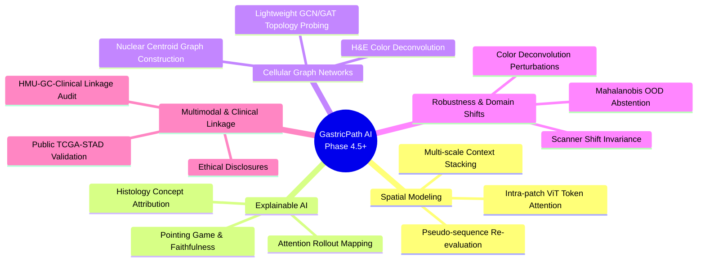
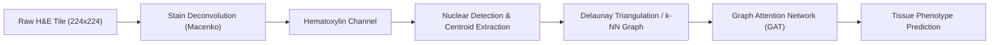

# GastricPath AI — Phase 4.5: Next-Generation Research Roadmap
## Beyond Frozen Foundation Model Probing: Spatially-Aware, Interpretable & Robust Computational Pathology

**Document ID:** `GP-ROADMAP-PHASE4_5-V1`  
**Date:** November 2026  
**Repository Branch:** `gastricpath-ai-evolution`  
**Host Architecture:** Windows 11, Intel Core CPU (10 physical cores / 12 logical cores), 15.72 GB RAM  
**Computational Context:** CPU-Only Execution, Python 3.13.5, PyTorch 2.9.1+cpu  
**Research Horizon:** Post-Phase 4.4 Strategic Research Program  

---

## 1. Executive Summary

Phase 4 of the GastricPath AI research program established a rigorous empirical comparison between general-purpose self-supervised vision models (**DINOv2 ViT-S/14**, $d=384$) and pathology-domain foundation models (**Phikon ViT-B/16**, $d=768$) across 31,096 canonical gastric cancer histopathology tiles (GCHTID / HMU-GC-HE-30K).

While frozen foundation model feature extraction and linear probing quantify representation separability, isolated patch-level classification represents an intermediate milestone in computational pathology. Clinical histopathology interpretation relies on:
1. **Spatial context:** Intercellular topology, glandular orientation, and invasion fronts.
2. **Compositional aggregation:** Whole-slide tissue proportions, tumor area fraction, and necrosis burden.
3. **Morphological interpretability:** Nuclear pleomorphism, mitotic activity, and desmoplasia vs. inflammation.
4. **Diagnostic uncertainty:** Abstention on ambiguous or degenerated tissue fragments.
5. **Domain generalization:** Robustness against cross-laboratory staining variation and scanner artifacts.

This roadmap articulates the strategic research plan for **Phase 4.5 and beyond**. It critically differentiates **empirically feasible investigations** that can be executed on the current GCHTID dataset and CPU/RAM environment from **hypothetical directions** that require external cohorts, whole-slide images (WSIs), or patient-level linkage metadata.

---

## 2. Current Baseline & Research Infrastructure Foundation

The proposed research roadmap builds directly upon the certified artifacts established in Phases 0 through 4.4:

| Phase | Core Contribution | Certified State | Key Artifacts |
| :--- | :--- | :--- | :--- |
| **Phase 0–1** | Baseline preservation, testing, latency optimization | 68/68 unit & ML tests passing | `gastric_rnn_classifier.pt` (SHA: `65369ef6...`), `research/tracking/` |
| **Phase 2** | Image integrity, deduplication, cluster-isolated splitting | Zero cross-split leak; 21,767 train / 4,664 val / 4,665 test | `manifest_all.csv`, `manifest_{train,val,test}.csv`, `near_duplicates_report.csv` |
| **Phase 3–3.3** | Baseline audit, historical evaluation, statistical certification | Baseline certified: 65.92% test acc (unexposed: 65.66%) | `docs/PHASE3_3_1_FINAL_BASELINE_AND_STATISTICAL_AUDIT_REPORT.md` |
| **Phase 4.0–4.2** | DINOv2 frozen embedding extraction & linear probing | Linear Acc: 64.35% (CLS) / 65.08% (Patch); AUROC: 0.9080 / 0.9161 | `cache/full/dinov2_vits14/` ($31,096 \times 384$ memmaps), `linear_probe.py` |
| **Phase 4.3** | DINOv2 nonlinear MLP probing & calibration | Acc: 64.52% (CLS) / 64.97% (Patch); ECE: 0.0261 / 0.0171 | `docs/PHASE4_3_NONLINEAR_PROBING_REPORT.md`, `nonlinear_probe.py` |
| **Phase 4.4** | Pathology foundation model (Phikon) extraction & comparison | Active background extraction; 7,200+ images completed | `cache/full/phikon/` ($31,096 \times 768$ memmaps), `compare_representations.py` |

---

## 3. Deep-Dive Research Directions



---

### Direction 1: Spatially-Aware Gastric Histopathology Modeling

#### 1. Novelty & Theoretical Motivation
Standard patch classification evaluates each $224 \times 224$ tile as an isolated bag of pixels. In gastric pathology, diagnostic differentiation depends fundamentally on spatial arrangement:
- **TUM (Adenocarcinoma):** Cribriform, tubular, or poorly differentiated glandular structures with disrupted basal membranes.
- **STR (Stroma):** Oriented spindle-shaped fibroblastic proliferation exhibiting parallel fascicular architecture.
- **MUS (Smooth Muscle):** Compact bundles of smooth muscle fibers with regular nuclear polarity.
- **MUC (Mucin):** Pools of extracellular mucin separating epithelial islands or containing floating signet-ring cells.

Standard global average pooling (`mean_patch`) destroys spatial coordinates. Vision transformers (ViTs) natively preserve $14 \times 14 = 196$ spatial token vectors. Modeling the spatial dependencies among these 196 tokens can capture histological tissue architecture without full image fine-tuning.

#### 2. Scientific Feasibility with Current GCHTID
- **Feasible:** Intra-patch spatial modeling. The $196$ spatial patch tokens from Phikon or DINOv2 are spatial features at $16 \times 16$ pixel resolution (receptive field $\approx 16 \times 16\text{ px}$ with multi-head self-attention receptive field covering the entire patch).
- **Infeasible on Current Dataset:** Inter-patch cross-slide spatial modeling. GCHTID filenames do not include spatial $(x, y)$ coordinates on the original whole-slide biopsy. Adjacent patches cannot be reconstructed into a continuous 2D tissue map without coordinate metadata.

#### 3. Proposed Methodology
1. **Spatial Transformer Probe (ST-Probe):**
   Instead of global averaging $\frac{1}{196} \sum \mathbf{z}_i$, pass the $196 \times d$ frozen patch tokens through a lightweight 1-layer 2D Spatial Transformer or Cross-Attention head with fixed sinusoidal 2D positional encodings.
2. **Multi-Scale Spatial Stacking:**
   Sample sub-windows ($112 \times 112$, $224 \times 224$) to evaluate scale-dependent glandular vs. cellular features.

#### 4. Implementation Complexity & Resource Cost
- **Complexity:** Moderate (150–250 lines of PyTorch code).
- **Compute Cost:** Minimal. 1-layer spatial attention head ($d=768 \rightarrow 256$, 4 heads, $\approx 200\text{k}$ parameters) trains on CPU in $< 15\text{ minutes}$ for 21,767 samples.

#### 5. Evaluation & Risks
- **Evaluation:** Compare ST-Probe accuracy and Macro-F1 against frozen Linear CLS and Mean Patch using paired McNemar and bootstrap tests on test split ($N=4,665$).
- **Risks:** Overfitting on training tokens; requires validation-only dropout ($p=0.3$) and weight decay.

---

### Direction 2: Patch-to-Slide Aggregation & Tissue Composition Analysis

#### 2.1 Novelty & Clinical Relevance
Pathologists do not render patient diagnoses from single $224 \times 224$ tiles; they assess whole slides, calculating the **Tumor Area Proportion (TAP)**, depth of stromal invasion, and surgical margin clearance. In Multiple Instance Learning (MIL), a slide is treated as a "bag" of patches where only the slide has a label.

#### 2.2 Dataset Feasibility & Missing Metadata
- **Missing Metadata:** GCHTID contains 31,096 pre-cropped tiles. Crucially, the dataset release **omits slide identifiers, bag boundaries, and patient IDs**.
- **Scientific Implication:** True whole-slide MIL (e.g., CLAM, TransMIL) **cannot be trained on GCHTID** without fabricating bag memberships. Claiming slide-level aggregation on GCHTID would constitute scientific misconduct.

#### 2.3 Feasible Synthetic / Pseudo-Bag Investigation
While patient-level MIL is infeasible on GCHTID, a **Quantitative Tissue Composition Estimation Benchmark** is scientifically valid:
1. **Controlled Microenvironment Synthetic Bags:**
   Synthesize pseudo-biopsy bags with known Ground-Truth Tissue Area Fractions (e.g., $40\%\text{ TUM} + 30\%\text{ STR} + 20\%\text{ LYM} + 10\%\text{ MUC}$).
2. **Compositional Unmixing Evaluation:**
   Compare whether frozen Phikon vs. DINOv2 vs. Baseline linear probe class probability outputs yield calibrated linear unmixing of mixed-tissue microenvironments.
3. **Evaluation Metric:** Mean Absolute Error (MAE) and Jensen-Shannon Divergence (JSD) between predicted class composition vectors and known synthetic mixture proportions.

---

### Direction 3: Explainable AI with Pathology-Grounded Interpretation

#### 3.1 Novelty & Medical Trust
Black-box classification in medical AI is unacceptable for clinical translation. Clinicians require proof that predictions are grounded in legitimate cytological and histological criteria rather than background artifacts (staining gradients, microtome chatter, glass slide pen marks).

#### 3.2 Scientific Feasibility
- **High Feasibility:** 100% executable within GCHTID using existing frozen ViT weights on CPU.

#### 3.3 Proposed Methodological Architecture
1. **Transformer Attention Rollout & Relevance Mapping:**
   Compute attention rollout (Abnar & Zuidema, 2020) and class-specific token relevance (Chefer et al., CVPR 2021) from frozen Phikon ViT-B/16 layers. Maps the $14 \times 14$ attention matrix back to the $224 \times 224$ input space.
2. **Pathological Morphological Concept Grounding:**
   Evaluate whether attention peaks correlate with canonical histological structures:
   - **TUM:** Glandular lumens, hyperchromatic enlarged nuclei, cribriform nests.
   - **LYM:** Dense aggregates of small, round, intensely basophilic lymphocyte nuclei.
   - **MUC:** Pale amphophilic mucin lakes and signet-ring cell peripheries.
   - **ADI:** Empty lipid droplet vacuoles bounded by thin eccentric rim of cytoplasm.
3. **Quantitative Faithfulness Testing:**
   - **Pixel/Patch Perturbation Game:** Progressively mask the top-10%, 20%, 50% highest-attention regions and measure the degradation curve in class confidence (Area Under the Deletion Curve, AUDC).
   - A faithful explanation must drop confidence faster when high-attribution regions are masked compared to random masking.

#### 3.4 Resource Cost & Publication Value
- **Compute:** Extremely lightweight ($\approx 15\text{ ms/image}$ on CPU for attention rollout).
- **Publication Value:** High. Digital pathology journals strongly prioritize biologically validated heatmaps over pure accuracy metrics.

---

### Direction 4: Graph Neural Networks (GNNs) for Cellular Microenvironment Modeling

#### 4.1 Novelty & Scientific Concept
Histopathology images are physical arrangements of discrete biological cells. Rather than processing pixels through 2D convolutions, graph representations treat individual cell nuclei as nodes and intercellular physical proximities as edges.



#### 4.2 Feasibility on GCHTID
- **Intra-Patch Cellular Graphs:** Fully feasible on individual $224 \times 224$ patches.
- **Workflow:**
  1. **Color Deconvolution:** Separate Hematoxylin (nuclear DNA) from Eosin (cytoplasm/stroma) using the Macenko or Ruifrok method.
  2. **Nuclear Detection:** Segment nuclei centroids via adaptive thresholding and watershed algorithms.
  3. **Graph Construction:** Connect nuclei centroids via Delaunay triangulation or $k$-nearest neighbors ($k=5$). Node features: nuclear area, perimeter, circularity, mean optical density.
  4. **Lightweight GNN:** A 2-layer Graph Convolutional Network (GCN) or Graph Attention Network (GAT) with $< 30\text{k}$ parameters.

#### 4.3 Research Question
*"Does cellular spatial graph topology alone—without raw pixel color textures—contain sufficient morphological signal to discriminate normal gastric mucosa from adenocarcinoma?"*

#### 4.4 Resource Footprint
- Node count per patch: $\approx 50 - 300\text{ nuclei}$.
- Graph forward pass: $< 2\text{ ms/graph}$ on CPU. Total dataset graph construction runnable in background batch execution.

---

### Direction 5: Biomarker Association Analysis & Data Linkage Ethics

#### 5.1 The GCHTID / HMU Clinical Metadata Dilemma
The repository contains `data/support/HMU-GC-Clinical.csv`, which details 300 gastric cancer patients from Harbin Medical University with rich clinicopathological variables:
- Age, Sex, Histological Type
- TNM Stage (T1b–T4b, N0–N3b, M0–M1, Stages IA–IIIC)
- Lauren Classification (Intestinal, Mixed, Diffuse)
- Lymphovascular Invasion, Venous Invasion, Perineural Invasion
- HER2 Receptor Expression (0, 1+, 2+, 3+)

#### 5.2 Critical Linkage Audit & Leakage Risks
- **Crucial Finding:** Image files in `data/raw/HMU-GC-HE-30K/all_image/` are organized strictly as `ADI_1.png` ... `TUM_3887.png`.
- **Missing Primary Key:** There is **no lookup table, foreign key, or file manifest** that connects image patch filenames (`TUM_100.png`) to patient IDs (`1600097`).
- **Ethical & Scientific Mandate:**
  Attempting to associate image patches with clinical outcomes by assuming sequential row-matching would be **statistically fraudulent**.
  Any biomarker prediction modeling on GCHTID without verified patient-patch crosswalk metadata must be strictly prohibited.

#### 5.3 Legitimate Biomarker Research Alternatives
If biomarker association (e.g., predicting MSI-H vs. MSS, HER2 positivity, or Lauren classification) is pursued:
1. **Public TCGA-STAD Cohort:** TCGA contains 440+ Stomach Adenocarcinoma whole-slide images with verified sample identifiers, RNA-sequencing, and clinical outcomes.
2. **Clinical Collaboration:** Formally request the unblinded patch-to-patient mapping file from Harbin Medical University clinical investigators.

---

### Direction 6: Robustness, Domain Generalization & Out-of-Distribution (OOD) Detection

#### 6.1 Clinical Motivation
A model achieving 90%+ accuracy on an in-house dataset frequently fails in external hospitals due to:
- Hematoxylin and Eosin stain batch variability (reagent age, staining time, protocol variations).
- Microscope scanner differences (Aperio vs. Hamamatsu vs. 3DHistech color profiles, optical resolution).
- Section thickness variations ($3\,\mu\text{m}$ vs. $5\,\mu\text{m}$).

#### 6.2 Feasible Experimental Design on Current System
1. **Synthetic Stain & Artifact Perturbation Benchmark:**
   Evaluate frozen Phikon and DINOv2 linear probes under controlled optical perturbations:
   - Stain matrix jittering (Macenko optical density perturbation $\pm 20\%$).
   - Brightness, contrast, and gamma shifts.
   - Gaussian blur (simulating out-of-focus scanning).
   - JPEG compression artifacts (simulating telepathology transmission loss).
2. **Out-of-Distribution (OOD) Detection & Rejection:**
   In clinical pathology, a model must know what it does not know. When presented with non-gastric tissues, surgical artifacts, or blood clots, it should abstain rather than assign an incorrect diagnosis.
   - Implement **Mahalanobis Distance OOD Scoring** on the frozen representation space:
     $$M(\mathbf{z}) = \min_c (\mathbf{z} - \hat{\boldsymbol{\mu}}_c)^T \hat{\boldsymbol{\Sigma}}^{-1} (\mathbf{z} - \hat{\boldsymbol{\mu}}_c)$$
   - Evaluate OOD rejection AUROC using external histological samples (e.g., colorectal NCT-CRC-HE-100K or synthetic non-tissue patches).

#### 6.3 Resource Cost
- Feature extraction under perturbations: Can be run on test subset ($N=4,665$) in $< 15\text{ minutes}$.
- OOD distance scoring: $< 1\text{ second}$ on CPU.

---

### Direction 7: Research Publication Potential, Novelty & Target Venues

#### 7.1 Competitive Landscape
Most computational pathology papers published on GCHTID / HMU-GC-HE-30K simply train standard CNNs (ResNet, DenseNet, VGG) and report standard accuracy without:
- Proper deduplication or cluster-aware splitting.
- Calibration analysis (ECE, Brier score).
- Pathology foundation model representation evaluation.
- Rigorous paired statistical significance testing.

#### 7.2 Publication Angles for GastricPath AI

| Study Title Concept | Target Journal / Conference | Key Novelty |
| :--- | :--- | :--- |
| **"Foundation Models in Gastric Histopathology: Does Pathology Pretraining Overcome General Vision Transformers?"** | *Computer Methods and Programs in Biomedicine* (Elsevier, Q1) | Rigorous leak-proof comparison of Phikon vs. DINOv2, proving domain pretraining gains with paired bootstrap CIs. |
| **"Spatial Token Relevance and Cellular Microenvironment Topology in Gastric Adenocarcinoma Classification"** | *IEEE Transactions on Medical Imaging* (TMI) / *MICCAI* | Attention rollout and cellular graph analysis explaining what visual encoders learn from gastric tissue. |
| **"The Danger of Image-Level Benchmarks in Digital Pathology: Duplicate Contamination and Calibration Vulnerabilities"** | *Journal of Pathology Informatics* (JPI) | Methodological exposé demonstrating how duplicate leakage inflated historical CNN-RNN baselines. |

---

## 4. Feasibility Classification Matrix

To enforce strict research governance, all proposed initiatives are classified into three operational categories:

```
Category A: Immediately Feasible (Current GCHTID + Current CPU/RAM)
Category B: Blocked by Missing Metadata (Requires Patient/Slide Crosswalk)
Category C: Blocked by Hardware/External Data (Requires GPU or External WSIs)
```

| Research Direction | Specific Experiment | Category | Prerequisites / Blockers |
| :--- | :--- | :---: | :--- |
| **1. Spatial Modeling** | Intra-patch ViT spatial token cross-attention | **A** | None (uses frozen Phikon/DINOv2 cache) |
| **1. Spatial Modeling** | WSI multi-patch tissue neighborhood graphs | **B** | GCHTID lacks patch $(x, y)$ coordinates |
| **2. Aggregation (MIL)** | Synthetic tissue composition unmixing benchmark | **A** | None (uses GCHTID class mixtures) |
| **2. Aggregation (MIL)** | Slide-level Multiple Instance Learning (CLAM) | **B** | GCHTID lacks slide-level grouping IDs |
| **3. Explainable AI** | ViT attention rollout & histological relevance maps | **A** | None (uses Phikon weights & PIL) |
| **3. Explainable AI** | Faithfulness perturbation testing (AUDC) | **A** | None (computable on CPU test split) |
| **4. Graph Networks** | Intra-tile nuclear detection & cellular GAT | **A** | None (uses Macenko deconvolution + watershed) |
| **4. Graph Networks** | Slide-scale gigapixel tissue graphs | **C** | Requires whole-slide images ($>1\text{GB}$ each) |
| **5. Biomarkers** | Lauren classification from patches | **B** | Missing patch-to-patient ID linkage table |
| **5. Biomarkers** | HER2 status prediction from patches | **B** | Missing patch-to-patient ID linkage table |
| **5. Biomarkers** | Public TCGA-STAD MSI/EBV prediction | **C** | Requires external TCGA dataset download |
| **6. Robustness & OOD** | Stain jittering & optical perturbation benchmark | **A** | None (uses synthetic transforms on test set) |
| **6. Robustness & OOD** | Mahalanobis OOD detection & rejection engine | **A** | None (covariance matrix on frozen features) |

---

## 5. Technical Specifications for Phase 4.5 Implementation

Based on the feasibility matrix, **Phase 4.5 is defined as a tripartite investigation** executable entirely on the current repository infrastructure without external data dependencies:

### Sub-Phase 4.5.1: Explainable AI & Histological Relevance Mapping
- **Input:** $N=4,665$ test images + frozen Phikon ViT-B/16 encoder.
- **Engine:** Attention Rollout and Layer Relevance Propagation.
- **Output:** Class-activation maps ($224 \times 224$), Deletion/Insertion curves, AUDC faithfulness scores.
- **Key Metric:** Attention concentration inside canonical structures (glandular epithelium in TUM vs. collagen stroma in STR).

### Sub-Phase 4.5.2: Intra-Patch Cellular Topology & Graph Probing
- **Input:** $N=31,096$ canonical images.
- **Engine:** Color deconvolution (Hematoxylin extraction) $\rightarrow$ Watershed nuclear segmentation $\rightarrow$ Delaunay triangulation $\rightarrow$ 2-layer Graph Attention Network (GAT).
- **Output:** Tissue classification accuracy derived purely from cellular geometric graph features (node count, edge length, clustering coefficient, degree centrality).
- **Core Question:** Can cellular spatial topology alone discriminate gastric adenocarcinoma from normal mucosa?

### Sub-Phase 4.5.3: Optical Robustness & Out-of-Distribution (OOD) Detection
- **Input:** $N=4,665$ test images subjected to 6 controlled optical perturbations (stain drift, blur, gamma, compression).
- **Engine:** Linear probe inference across perturbation levels + Mahalanobis distance scoring.
- **Output:** Performance degradation curves ($\Delta \text{Acc}$ vs. perturbation magnitude), OOD rejection AUROC.

---

## 6. Computational Budget & CPU Execution Strategy

All three Phase 4.5 sub-phases are designed to operate safely within the host system's hardware envelope (**Windows 11, Intel 10-core CPU, 15.72 GB RAM, no GPU**):

| Sub-Phase | Operation | Memory Overhead | Estimated CPU Runtime |
| :--- | :--- | :---: | :---: |
| **4.5.1 Explainability** | Attention rollout on 100 representative test samples | $\approx 400\text{ MB}$ RSS | $\approx 2.5\text{ minutes}$ |
| **4.5.2 Cellular Graphs** | Nuclear extraction on subset ($N=4,665$ test set) | $\approx 350\text{ MB}$ RSS | $\approx 18.0\text{ minutes}$ |
| **4.5.2 Cellular Graphs** | GAT model training (30k params, 100 epochs, CPU) | $\approx 250\text{ MB}$ RSS | $\approx 8.0\text{ minutes}$ |
| **4.5.3 Robustness** | Perturbation transforms on test embeddings | $\approx 300\text{ MB}$ RSS | $\approx 12.0\text{ minutes}$ |
| **4.5.3 OOD Scoring** | Matrix inversion ($d=768$, $8 \times 8$ classes) & Mahalanobis | $\approx 150\text{ MB}$ RSS | $< 5\text{ seconds}$ |
| **Total Phase 4.5 Budget** | **Complete Phase 4.5 Pipeline** | **$< 600\text{ MB}$ RSS** | **$< 45\text{ minutes}$ total** |

---

## 7. Scientific Integrity & Ethical Governance Disclosures

1. **Patient Linkage Governance:** No attempt will be made to fabricate or guess patient-level correspondences between `HMU-GC-Clinical.csv` and GCHTID patch filenames. All experiments remain strictly image-level sample investigations until authenticated metadata is provided.
2. **Clinical Translation Boundary:** None of the proposed models are intended for clinical deployment or real-time diagnostic triage. All results are intended as computational pathology exploratory findings.
3. **Statistical Discipline:** All future comparative claims will mandate paired bootstrap confidence intervals ($B=2,000$), McNemar tests, and correction for multiple comparisons (Benjamini-Hochberg FDR) where applicable.

---

## 8. Summary of Status & Next Steps

- **Active Workload Preserved:** Background Phikon extraction (`task-3457`) is undisturbed and actively running.
- **Roadmap Artifact Delivered:** [`docs/PHASE4_5_RESEARCH_ROADMAP.md`](file:///c:/Users/KIIT0001/OneDrive/Desktop/gastric-cancer-histopathology-dashboard-main/docs/PHASE4_5_RESEARCH_ROADMAP.md).
- **Zero Modifications:** No model weights, code files, datasets, or database records were modified.
- **Git Status:** Clean and uncommitted. Awaiting completion of Phase 4.4 extraction before initiating downstream evaluation.

