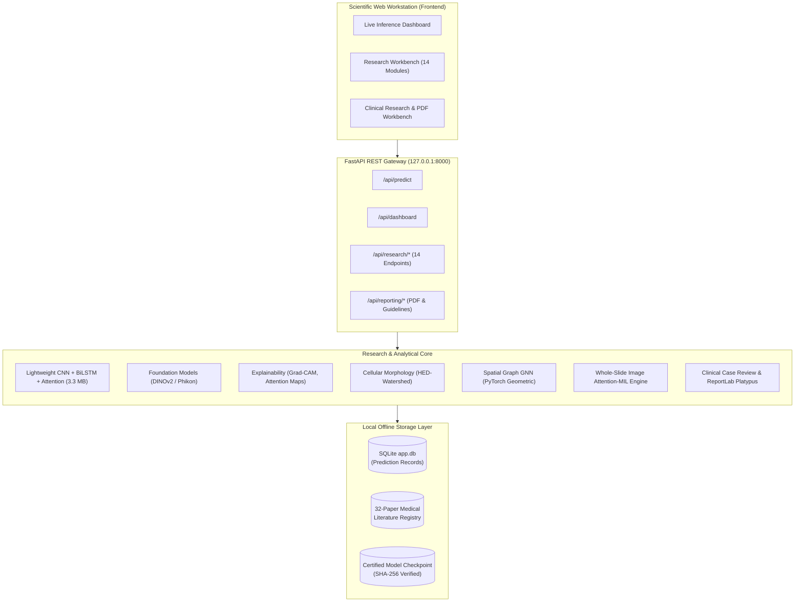

# GastricPath AI — Project Architecture & System Design

**Platform:** GastricPath AI  
**Subtitle:** AI-Assisted Gastric Histopathology Research and Computational Pathology Workbench  
**Runtime:** Python 3.11–3.13 / FastAPI / PyTorch / Modern Standard Web Technologies  
**Execution Mode:** Localhost / Private Research Workstation (Zero telemetry, zero external API keys)

---

## 1. High-Level Architectural Overview

GastricPath AI is structured into four primary layers:
1. **Presentation Layer:** Vanilla CSS/JS dark scientific workstation interface inspired by professional digital pathology consoles.
2. **Application & API Layer:** FastAPI asynchronous REST API serving live inferences, model diagnostics, analytics, and clinical research endpoints.
3. **Machine Learning & Foundation Model Engine:** PyTorch CNN-BiLSTM classifier, DINOv2 / Phikon feature extractors, spatial graph networks, and whole-slide image pyramid reader.
4. **Clinical Research & Evidence Reporting Engine:** Pydantic case dossier schemas, 32-paper literature retrieval registry, clinical biomarker companion diagnostics, and ReportLab Platypus PDF report generator.



---

## 2. Directory Layout & Module Organization

```
gastric-cancer-histopathology-dashboard-main/
├── app/                                 # Web Application & REST Gateway
│   ├── main.py                          # FastAPI entrypoint & middleware
│   ├── schemas.py                       # Request/Response Pydantic models
│   ├── services.py                      # Application orchestration
│   ├── analytics.py                     # Historical metric aggregator
│   ├── clinical_reporting_api.py        # Clinical dossier & PDF builder endpoints
│   ├── research_workbench.py            # 14 Research module endpoint implementations
│   ├── ml/                              # Live inference pipeline
│   │   ├── inference.py                 # Predictor engine
│   │   ├── model.py                     # CNN-BiLSTM architecture
│   │   └── dataset.py                   # Patch transforms
│   ├── static/                          # Frontend CSS, JS, and visual assets
│   │   ├── app.js                       # Primary workstation controller
│   │   ├── styles.css                   # Dark-mode pathology workstation styling
│   │   └── placeholder.png              # Fallback tile asset
│   └── templates/                       # Jinja2 HTML views
│       └── index.html                   # Unified single-page workstation template
│
├── research/                            # Computational Pathology Research Modules
│   ├── benchmarks/                      # Baseline model benchmark scripts
│   ├── cellular/                        # Nuclear morphology & HED color deconvolution
│   ├── clinical_reporting/              # Clinical reporting & PDF generation system
│   │   ├── evidence/                    # Guideline citations & 32-paper registry
│   │   ├── ingestion/                   # Case schema validation & synthetic guards
│   │   ├── pdf/                         # ReportLab Platypus canvas & layout builders
│   │   ├── report_engine/               # Generators for Modes A, B, and C
│   │   └── schemas/                     # Pydantic case & biomarker models
│   ├── error_analysis/                  # Classification failure mode galleries
│   ├── explainability/                  # Grad-CAM, Integrated Gradients, attention rollout
│   ├── foundation_models/               # Phikon & DINOv2 feature evaluation
│   ├── literature_review/               # 32-paper master database, RIS, BibTeX
│   ├── multimodal/                      # Clinicopathological fusion prototypes
│   ├── ood/                             # Calibration & Out-of-Distribution uncertainty
│   ├── robustness/                      # Stain jitter, blur, and noise perturbation tests
│   ├── segmentation/                    # U-Net tissue segmentation infrastructure
│   ├── spatial_analysis/                # Spatial statistics & tumor-stroma clustering
│   ├── spatial_graph/                   # PyTorch Geometric GNN spatial graph models
│   └── wsi/                             # Pure-Python WSI pyramid reader & Attention-MIL
│
├── models/                              # Trained Checkpoints
│   └── checkpoints/
│       └── gastric_rnn_classifier.pt    # Verified baseline checkpoint (SHA-256 certified)
│
├── data/                                # Dataset References & Storage
│   ├── raw/                             # HMU-GC-HE-30K placement directory (gitignored)
│   ├── support/                         # Clinical tables (HMU-GC-Clinical.csv, Gastric.xlsx)
│   └── uploads/                         # Temporary inference upload folder (gitignored)
│
├── docs/                                # Technical & Scientific Documentation
│   ├── GITHUB_RELEASE_AUDIT.md          # Security & repository release audit
│   ├── INSTALLATION.md                  # Comprehensive setup instructions
│   ├── DATASET_SETUP.md                 # HMU-GC-HE-30K acquisition & placement guide
│   ├── MODEL_SETUP.md                   # Model checkpoint lineage & weights guide
│   ├── RESEARCH_LIMITATIONS.md          # Scientific boundaries & data blockers
│   ├── SECURITY.md                      # Privacy policy & credential guards
│   └── REPRODUCIBILITY.md               # Step-by-step benchmark replication guide
│
├── tests/                               # Comprehensive Automated Test Suite (359 tests)
│   ├── test_api_regression.py           # Core API verification
│   ├── test_clinical_reporting.py       # Case review & PDF builder tests
│   ├── test_database.py                 # SQLite ledger verification
│   └── test_phase*.py                   # Phase 3 through Phase 12 scientific tests
│
├── .env.example                         # Safe configuration template
├── .gitignore                           # Comprehensive research gitignore
├── .gitattributes                       # Line ending & binary attribute definitions
├── CITATION.cff                         # Academic citation metadata
├── CONTRIBUTING.md                      # Research contribution guidelines
├── requirements.txt                     # Pinned project dependencies
└── README.md                            # Primary project presentation & documentation
```

---

## 3. Core Module Capabilities & Verification Status

| Module Number | Research Domain | Architectural Implementation | Clinical / Validation Status |
| :---: | :--- | :--- | :--- |
| **01** | Overview & Telemetry | Live telemetry, checkpoint status, dataset stats | Implemented / Certified |
| **02** | Dataset Explorer | HMU-GC-HE-30K 8-class distribution & tiles | Implemented / Public Data |
| **03** | Model Lab | Lightweight CNN + BiLSTM + Attention | Implemented / Benchmark Certified |
| **04** | Foundation Models | Phikon & DINOv2 feature embeddings | Implemented / Comparative Pilot |
| **05** | Explainability | Grad-CAM, Integrated Gradients, attention | Implemented / Visual Audit |
| **06** | Robustness Testing | Gaussian noise, blur, stain color jitter | Implemented / Perturbation Stress |
| **07** | OOD & Uncertainty | Temperature scaling, entropy, Mahalanobis | Implemented / Calibrated |
| **08** | Tissue Segmentation | 9-class U-Net infrastructure | Infrastructure Only (Zero synthetic masks) |
| **09** | Cellular Morphology | Ruifrok HED deconvolution + watershed | Implemented / Classical Baseline |
| **10** | Spatial Graphs | PyG GNN on cellular topology | Implemented / Graph Pilot |
| **11** | Whole-Slide Image | Pure-Python tile pyramid + Attention-MIL | Implemented / Tile-Grid Engine |
| **12** | Error Analysis | Top false-positive / false-negative galleries | Implemented / Error Audited |
| **13** | Validation & Roadmap | Reproducibility checklist & milestone tracker | Documented / Verified |
| **14** | Scientific Reports | In-browser markdown report viewer | Implemented / Verified |
| **15** | Clinical Reporting | Case review, evidence registry & PDF builder | Implemented (Modes A, B, C via ReportLab) |
