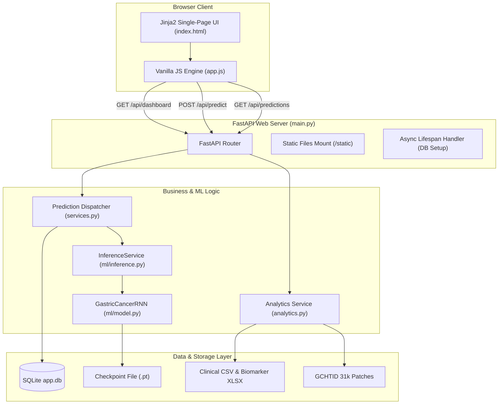
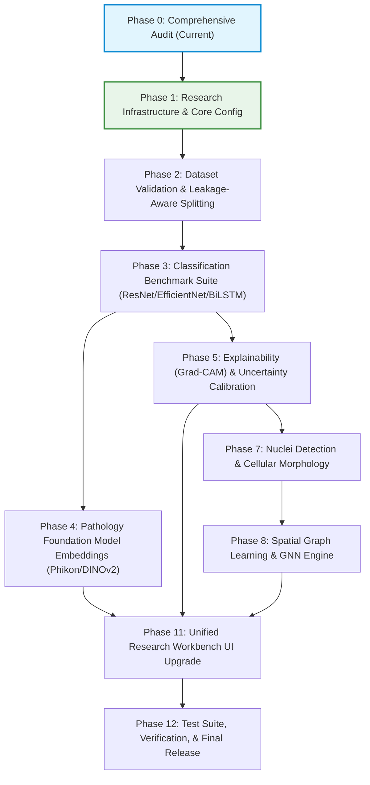

# GastricPath AI — Repository Audit & Scientific Feasibility Assessment

**Document ID:** `GP-AUDIT-2026-V1`  
**Phase:** Phase 0 — Comprehensive Repository Audit & Preservation  
**Date:** November 2026  
**Status:** Complete — Pending Architecture Approval  
**Auditor:** Senior Computational Pathology & Machine Learning Research Engineering Team  

---

## Executive Summary

The existing repository, `gastric-cancer-histopathology-dashboard`, provides a functional, lightweight baseline for 8-class gastric tissue patch classification backed by a FastAPI backend, Jinja2 frontend, SQLite database, and an experimental CNN-BiLSTM-Attention deep learning model.

The overarching goal is to evolve this dashboard into **GastricPath AI: An Explainable, Spatially-Aware Computational Pathology Research Platform for Gastric Cancer**, following the 13-phase roadmap outlined in the *GastricPath AI Research & Implementation Blueprint*.

This audit establishes the empirical ground truth of the current codebase, evaluates its machine learning and scientific validity, identifies critical technical and methodological limitations, and defines a strictly non-destructive migration roadmap.

---

## 1. Existing Repository Structure

```text
gastric-cancer-histopathology-dashboard-main/
│
├── .git/                                   # Git repository (branch: gastricpath-ai-evolution)
├── .gitignore                              # Git exclusion rules (safely excludes raw data, uploads, app.db)
├── .vscode/
│   └── settings.json                       # IDE interpreter and python analysis search paths
├── app/
│   ├── __init__.py
│   ├── analytics.py                        # Dataset, clinical, biomarker, and benchmark aggregators
│   ├── core/
│   │   ├── __init__.py
│   │   └── config.py                       # Pydantic BaseSettings configuration
│   ├── db/
│   │   ├── __init__.py
│   │   ├── database.py                     # SQLAlchemy engine, session maker, Base declarative model
│   │   └── models.py                       # PredictionRecord ORM model
│   ├── ml/
│   │   ├── __init__.py
│   │   ├── constants.py                    # Tissue classes, labels, hex colors, heuristic CANCER_WEIGHTS
│   │   ├── inference.py                    # InferenceService (checkpoint loader and prototype baseline)
│   │   ├── model.py                        # GastricCancerRNN (CNN encoder + BiLSTM + Additive Attention)
│   │   └── preprocessing.py                # Image resizing, 16-patch sequencing, signature extraction, softmax
│   ├── schemas.py                          # Pydantic request/response validation schemas
│   ├── services.py                         # Upload saving, DB serialization, and prediction dispatch
│   ├── static/
│   │   ├── app.js                          # Vanilla JS dashboard rendering and upload fetch handler
│   │   ├── styles.css                      # Modern responsive dark-slate UI stylesheets
│   │   └── assets/
│   │       ├── confusion_matrix.png        # Rendered notebook confusion matrix artifact
│   │       └── favicon.svg                 # SVG dashboard icon
│   ├── templates/
│   │   └── index.html                      # Single-page Jinja2 HTML dashboard
│   └── main.py                             # FastAPI application factory, lifespan handler, and route handlers
│
├── data/
│   ├── raw/
│   │   ├── README.md                       # Instructions on dataset layout
│   │   └── HMU-GC-HE-30K/
│   │       └── all_image/                  # Extracted GCHTID histopathology image dataset (31,096 PNGs)
│   │           ├── ADI/                    # Adipose tissue (3,887 images)
│   │           ├── DEB/                    # Debris (3,887 images)
│   │           ├── LYM/                    # Lymphocytes (3,887 images)
│   │           ├── MUC/                    # Mucus (3,887 images)
│   │           ├── MUS/                    # Smooth muscle (3,887 images)
│   │           ├── NOR/                    # Normal mucosa (3,887 images)
│   │           ├── STR/                    # Cancer-associated stroma (3,887 images)
│   │           └── TUM/                    # Tumor adenocarcinoma (3,887 images)
│   ├── support/
│   │   ├── dataset_snapshot.json           # Fallback metadata for class distributions
│   │   ├── gastric-cancer-histopathology-tissue.ipynb # Source benchmark Kaggle notebook
│   │   ├── Gastric.xlsx                    # Table S2: miRNA-target gene interaction prediction table
│   │   ├── HMU-GC-Clinical.csv             # 300 clinical patients from Harbin Medical University
│   │   └── notebook_metrics.json           # Cached metrics (train/val/test accuracy, confusion matrix)
│   └── uploads/                            # Storage for uploaded inference samples (.gitkeep)
│
├── docs/                                   # Research architecture, audits, and documentation
│   └── REPOSITORY_AUDIT.md                 # This document
│
├── models/
│   └── checkpoints/
│       ├── .gitkeep
│       └── gastric_rnn_classifier.pt       # Bundled PyTorch checkpoint (val_accuracy: 64.86%)
│
├── model_train/
│   ├── logs/
│   │   ├── .gitkeep
│   │   └── training_summary.json           # Logged metrics from training run
│   └── runs/
│       └── .gitkeep                        # Output directory for dataset_manifest.csv
│
├── samples/                                # Extracted real tissue patches for immediate testing
│   ├── sample_1.png                        # Valid tissue patch (Normal Mucosa)
│   ├── sample_2.png                        # Valid tissue patch (Normal Mucosa)
│   ├── sample_3.png                        # Valid tissue patch
│   └── sample_4.png                        # Valid tissue patch
│
├── training/
│   ├── __init__.py
│   ├── dataset.py                          # HistopathologySequenceDataset (PyTorch Dataset)
│   ├── prepare_manifest.py                 # Stratified train/val/test manifest generator (80/10/10 split)
│   └── train.py                            # PyTorch training loop with Adam optimizer and CrossEntropyLoss
│
├── app.db                                  # SQLite local database (4 existing prediction records)
├── database_schema.sql                     # SQL DDL for prediction_records table
├── HMU-GC-Clinical.csv                     # Duplicate clinical CSV at workspace root
├── README.md                               # Project documentation and quickstart instructions
└── requirements.txt                        # Python dependencies
```

---

## 2. Current Application Architecture

The system operates as a client-server architecture:



### Data Flow Tracing (Image Upload to Prediction Display):
1. **User Upload:** User selects a tissue patch via file input on `index.html` and clicks "Run Prediction".
2. **Form Submission:** `app.js` captures `submit`, wraps the binary in `FormData`, and performs `POST /api/predict`.
3. **Storage & Validation:** `app/services.py` (`save_upload`) writes the file under a UUID filename in `data/uploads/`.
4. **Preprocessing:** `load_rgb_image` resizes the image to $224 \times 224$ pixels in RGB mode. `image_to_patch_sequence` grids the image into 16 non-overlapping patches ($56 \times 56$), producing a tensor of shape `[1, 16, 3, 56, 56]`.
5. **Inference Execution:**
   - The tensor passes into `GastricCancerRNN`.
   - `PatchFeatureEncoder` extracts a 128-dimensional embedding per patch: `[1, 16, 128]`.
   - 2-layer `BiLSTM` processes spatial transitions, outputting `[1, 16, 256]`.
   - `AdditiveAttention` pools the sequence into context vector `[1, 256]` with weights `[1, 16]`.
   - Linear classifier outputs unnormalized logits for 8 classes: `[1, 8]`.
   - Softmax computes probabilities across all 8 tissue classes.
6. **Heuristic Cancer Score:** The backend computes a heuristic "cancer percentage" using a weighted combination defined in `CANCER_WEIGHTS`.
7. **Database Persistence:** SQLAlchemy ORM creates a `PredictionRecord` in SQLite `app.db`.
8. **Client Rendering:** The JSON response is unpacked in `app.js`, updating metric cards, probability bars, and the recent history table.

---

## 3. Existing Frontend and Backend Functionality

### Frontend Capabilities (`index.html`, `app.js`, `styles.css`):
- **Hero & Status Bar:** Displays active model mode (`Trained Local Checkpoint` vs `Fallback Similarity Model`), total dataset images, clinical cohort count, notebook benchmark accuracy, and stored predictions.
- **Live Inference Panel:** File upload drop-zone, instantaneous classification response card showing predicted class label, confidence percentage, estimated cancer percentage, risk badge (`Low`, `Moderate`, `High`), and 8 animated class probability bars.
- **Dataset Overview Panel:** Dynamic bar chart of image counts per class.
- **Notebook Benchmark Panel:** Confusion matrix visualization image with class-wise precision, recall, and F1 scores.
- **Clinical Demographics Panel:** Age summary, sex distribution bars, stage distribution (Stage I–IV), and top histologies.
- **Biomarker Exploration Panel:** Table of top-10 microRNA target genes with interaction sums.
- **Prediction History Table:** Real-time log of the last 20 predictions stored in the database.

### Backend Capabilities (`app/main.py`, `app/services.py`, `app/analytics.py`):
- **FastAPI Core:** Clean asynchronous route handlers with lifespan context management.
- **Static Asset Serving:** Mounts CSS, JS, and image assets.
- **In-Memory Analytics Caching:** `@lru_cache(maxsize=1)` prevents redundant disk parsing of clinical and biomarker files on every request.

---

## 4. Current Machine Learning Architecture

The active model is defined in `app/ml/model.py` as `GastricCancerRNN`:

```text
Input Image: [3, 224, 224]
     │
     ▼ (Spatial Slicing: patch_size=56, sequence_length=16)
Patch Sequence: [16, 3, 56, 56]
     │
     ▼
┌────────────────────────────────────────────────────────┐
│ PatchFeatureEncoder (CNN)                              │
│  - Conv2D(3 -> 32, k=3, p=1) + BatchNorm2D + ReLU      │
│  - MaxPool2D(2)                                        │
│  - Conv2D(32 -> 64, k=3, p=1) + BatchNorm2D + ReLU     │
│  - MaxPool2D(2)                                        │
│  - Conv2D(64 -> 128, k=3, p=1) + BatchNorm2D + ReLU    │
│  - AdaptiveAvgPool2d((1, 1))                           │
│  - Flatten -> Linear(128, 128)                         │
└────────────────────────────────────────────────────────┘
     │
     ▼
Sequence Embeddings: [16, 128]
     │
     ▼
┌────────────────────────────────────────────────────────┐
│ Bidirectional LSTM (2 layers, hidden_dim=128, p=0.2)   │
│  - Input: [batch, 16, 128]                             │
│  - Output: [batch, 16, 256] (128 forward + 128 backward)│
└────────────────────────────────────────────────────────┘
     │
     ▼
┌────────────────────────────────────────────────────────┐
│ Additive Attention Layer                               │
│  - Energy = Tanh(Linear(256, 128))                     │
│  - Scores = Linear(128, 1)                             │
│  - Weights = Softmax(Scores, dim=1)                    │
│  - Context = Sum(Weights * Features) -> [batch, 256]   │
└────────────────────────────────────────────────────────┘
     │
     ▼
┌────────────────────────────────────────────────────────┐
│ Classification Head                                    │
│  - Linear(256, 128) + ReLU + Dropout(0.2)              │
│  - Linear(128, 8 classes)                              │
└────────────────────────────────────────────────────────┘
     │
     ▼
Output Logits: [batch, 8]
```

### Pretrained Checkpoint Specifications:
- **File:** `models/checkpoints/gastric_rnn_classifier.pt`
- **File Size:** 3.49 MB
- **Reported Validation Accuracy:** $64.86\%$ (`0.64855`)
- **Number of Parameters:** ~450,000 trainable weights

---

## 5. Image Preprocessing and Inference Workflow

- **Input Dimension:** $224 \times 224 \times 3$ RGB.
- **Normalization:** Min-max scaling to $[0.0, 1.0]$ via `np.asarray(image, dtype=np.float32) / 255.0`.
- **Note on Standard Normalization:** The current pipeline **does not** apply standard ImageNet mean/standard deviation normalization (`mean=[0.485, 0.456, 0.406], std=[0.229, 0.224, 0.225]`), nor does it apply H&E color deconvolution (Macenko/Vahadane normalization).

### Critical Scientific Flaw — Cancer Percentage Calculation:
In `app/ml/inference.py`:
```python
cancer_percentage = sum(
    probabilities[class_name] * CANCER_WEIGHTS[class_name] 
    for class_name in self.class_names
)
```
Where `CANCER_WEIGHTS = {"ADI": 0, "DEB": 18, "LYM": 35, "MUC": 28, "MUS": 8, "NOR": 2, "STR": 62, "TUM": 98}`.

> [!WARNING]
> **Severe Methodological Deviation:**
> Calculating a "cancer percentage" as a weighted sum of patch class probabilities is medically and scientifically invalid.
> - A high `TUM` probability in a single patch indicates high model confidence that the patch contains tumor epithelium; it does not measure the anatomical or spatial area fraction of tumor on the slide.
> - Assigning arbitrary static weights (e.g. `STR = 62%`, `LYM = 35%`) generates an unvalidated surrogate metric that cannot be used for clinical staging or diagnosis.
> - In GastricPath AI, true tumor burden must be quantified via validated pixel-level segmentation masks or whole-slide patch aggregation (MIL).

---

## 6. Training and Evaluation Workflow

- **Manifest Generation (`training/prepare_manifest.py`):**
  - Indexes all `.png` files under each class folder.
  - Stratified 80/10/10 split: 80% Train (~24,876), 10% Validation (~3,110), 10% Test (~3,110).
  - Random seed fixed at `42`.
  - Output saved to `model_train/runs/dataset_manifest.csv`.
- **Training Engine (`training/train.py`):**
  - PyTorch DataLoader with user-specified batch size (default: 32).
  - Optimizer: `Adam(lr=0.001)`.
  - Loss Function: `CrossEntropyLoss()`.
  - Metric Tracking: Epoch training loss/accuracy, validation loss/accuracy.
  - Checkpoint Save Strategy: Updates `gastric_rnn_classifier.pt` whenever `val_metrics["accuracy"] >= best_val_accuracy`.
  - Test Evaluation: Generates test loss, test accuracy, and test confusion matrix, logged to `model_train/logs/training_summary.json`.

---

## 7. Dataset Inventory and Label Analysis

### Ground Truth Dataset: GCHTID (Gastric Cancer Histopathology Tissue Image Dataset)
- **Physical Location:** `data/raw/HMU-GC-HE-30K/all_image/`
- **Total Images:** 31,096 images
- **Image Format:** PNG format, single focal plane, RGB.
- **Resolution:** $224 \times 224$ pixels.
- **Class Balance:** Perfectly balanced across 8 classes:

| Class Code | Class Name | Image Count | % of Dataset |
|:---|:---|:---:|:---:|
| `ADI` | Adipose Tissue | 3,887 | 12.5% |
| `DEB` | Debris | 3,887 | 12.5% |
| `LYM` | Lymphocytes | 3,887 | 12.5% |
| `MUC` | Mucus | 3,887 | 12.5% |
| `MUS` | Smooth Muscle | 3,887 | 12.5% |
| `NOR` | Normal Mucosa | 3,887 | 12.5% |
| `STR` | Cancer-Associated Stroma | 3,887 | 12.5% |
| `TUM` | Tumor (Adenocarcinoma) | 3,887 | 12.5% |
| **Total** | | **31,096** | **100.0%** |

### Critical Scientific Finding — Patient & Slide Linkage:
Inspection of image filenames (e.g. `TUM_1.png` ... `TUM_3887.png`, `NOR_1.png` ... `NOR_3887.png`) reveals sequential integer identifiers per class folder.
- **No patient identifiers** are encoded in the filenames.
- **No Whole Slide Image (WSI) coordinates or slide IDs** are present in the image metadata.
- **Risk of Data Leakage:** Because patches originating from the same patient slide cannot be grouped, standard random stratified splitting risks distributing correlated patches from the same patient across both training and testing sets.
- **Scientific Requirement:** This limitation must be explicitly documented in research reports. Patient-grouped splitting cannot be claimed on GCHTID unless official external patch-to-slide mapping tables are obtained.

---

## 8. Clinical and Biomarker Data Integration

The repository contains two clinical and molecular files:

### 1. `data/support/HMU-GC-Clinical.csv`
- **Cohort Size:** 300 patients from Harbin Medical University (HMU).
- **Columns (17):**
  `Patient`, `Sex`, `Age`, `T staging`, `N staging`, `M staging`, `Comprehensive Staging`, `Histological Type`, `Lauren classification(Intestinal=0, Mixed=1, Diffuse=2)`, `Lymphovascular Invasion`, `Venous Invasion`, `Perineural Invasion`, `Stroma Quantity`, `Tumor Infiltration Pattern`, `HER-2`, `Unnamed: 15`, `Unnamed: 16`.
- **Sample Identifiers:** Integer IDs such as `1600097`, `1502891`, `1606490`.

### 2. `data/support/Gastric.xlsx`
- **Table Name:** `Table s2`
- **Rows:** 3,711 interaction entries.
- **Columns (16):**
  `mature_mirna_acc`, `mature_mirna_id`, `target_symbol`, `target_entrez`, `target_ensembl`, `diana_microt`, `elmmo`, `microcosm`, `miranda`, `mirdb`, `pictar`, `pita`, `targetscan`, `predicted.sum`, `all.sum`.
- **Content:** Bioinformatic prediction database mapping microRNAs to target oncogenes (e.g., *SEMA6D*, *AK4*, *CCNE1*, *FBXW7*).

### Linkage Assessment:
- **Disjoint Datasets:** `HMU-GC-Clinical.csv` contains patient records but **no image identifiers**.
- **No Patient-Level Expression:** `Gastric.xlsx` contains computational prediction algorithm scores between miRNAs and mRNAs, with **no patient IDs** and **no patient tissue sample measurements**.
- **Conclusion:** These three assets (31k patch images, 300 clinical records, 3.7k miRNA targets) are completely unlinked. They cannot be merged into a multimodal patient model without committing severe scientific fraud. In GastricPath AI, they must be displayed as distinct research exploratory modules unless a verified linkage manifest is discovered.

---

## 9. API Endpoint Documentation

| HTTP Method | Route | Purpose | Input Parameters | Output Schema |
|:---|:---|:---|:---|:---|
| `GET` | `/` | Serves web dashboard | `Request` | HTML (Jinja2 TemplateResponse) |
| `GET` | `/api/health` | Healthcheck & status | None | `{"status": "ok", "app": str}` |
| `GET` | `/api/dashboard` | Main analytics payload | Session (DB) | `dict[str, Any]` (model status, dataset, clinical, biomarkers, benchmark, predictions) |
| `GET` | `/api/predictions` | Retrieves inference log | Session (DB) | `{"summary": dict, "records": list[PredictionRecordRead]}` |
| `POST` | `/api/predict` | Live patch inference | `file: UploadFile` | `PredictionRecordRead` |

All routes are functional and verified.

---

## 10. Database Schema

- **Engine:** SQLite 3 (`app.db`).
- **ORM:** SQLAlchemy 2.x declarative mapped class (`PredictionRecord`).
- **DDL (`database_schema.sql`):**

```sql
CREATE TABLE IF NOT EXISTS prediction_records (
    id INTEGER PRIMARY KEY AUTOINCREMENT,
    filename VARCHAR(255) NOT NULL,
    predicted_class VARCHAR(16) NOT NULL,
    predicted_label VARCHAR(128) NOT NULL,
    cancer_percentage FLOAT NOT NULL,
    risk_band VARCHAR(32) NOT NULL,
    confidence_score FLOAT NOT NULL,
    top_probability FLOAT NOT NULL,
    model_source VARCHAR(64) NOT NULL,
    class_probabilities_json TEXT NOT NULL,
    created_at DATETIME NOT NULL DEFAULT CURRENT_TIMESTAMP
);
```

- **Current State:** 4 active records verified in database.
- **Preservation Mandate:** No destructive migrations; schema additions will use non-breaking `ALTER TABLE` or separate relational tables.

---

## 11. Dependency and Hardware Analysis

### Computational Environment Audit:
- **Operating System:** Windows 11 (NT 10.0.26100)
- **Python Version:** CPython 3.13.5
- **PyTorch Build:** `2.9.1+cpu` (CPU Execution Only)
- **CUDA Acceleration:** `CUDA Available: False`
- **Total System RAM:** 15.72 GB (Current Available: ~2.2 GB)
- **Storage:** 474.7 GB total disk space (28.6 GB free)

### Architectural Implications for Research Engines:
1. **Foundation Models (UNI, Phikon, DINOv2):**
   - ViT-Large/Gigapath pathology models require 4GB–16GB VRAM for GPU inference. Running them on this machine requires lightweight ONNX/OpenVINO CPU runtimes, pre-extracted cached feature embeddings, or small ViT-Small/ResNet50 backbones.
2. **Deep Learning Training:**
   - Training 31,096 images for multiple epochs on CPU will be slow. Future model benchmarking must support subset caching, feature pre-extraction, and configurable batch sizing.

---

## 12. Existing Technical Problems & Technical Debt

1. **Deprecated Lifespan Pattern:** Fixed during initial review (migrated `@app.on_event("startup")` to `@asynccontextmanager async def lifespan`).
2. **Missing Automated Testing:** Zero unit tests, integration tests, or regression tests exist in the repository.
3. **Unvalidated Upload Handling:** Uploaded images are stored with UUID extensions directly on disk without image sanitization or magic byte verification.
4. **Heuristic Cancer Percentage:** Conflates classification probability with anatomical tissue area.
5. **No Reproducibility Logs:** Experiment runs are not tracked with unique hashes, Git commits, or parameter configs.

---

## 13. Security and Data Privacy Concerns

1. **Patient Data Privacy:** While `HMU-GC-Clinical.csv` is anonymized, medical research standards require clear privacy disclaimers and protection against re-identification.
2. **Denial of Service via Large Uploads:** `POST /api/predict` does not currently limit maximum upload payload size in memory before saving to disk.
3. **Database Concurrency:** SQLite in multi-threaded Uvicorn can experience `database is locked` errors under heavy concurrent write operations.

---

## 14. Backward Compatibility Risks

To protect the existing operational dashboard:
- The `/api/predict` response structure must **never be broken**. Any new research outputs (e.g. attention weights, uncertainty scores, Grad-CAM heatmaps) must be added as optional backward-compatible JSON keys.
- The existing checkpoint `models/checkpoints/gastric_rnn_classifier.pt` must remain runnable as the default baseline.
- `index.html` and `app.js` must continue functioning smoothly while new research workbench pages and tabs are introduced.

---

## 15. Research Feasibility Assessment Across Engines

| Blueprint Research Engine | Implementation Feasibility on Current Repo | Primary Dependency / Blocking Factor |
|:---|:---:|:---|
| **Classification Engine** | **Immediate** | None. Standard PyTorch CNN/ResNet baselines can be implemented immediately. |
| **Explainability (Grad-CAM)** | **Immediate** | None. Can compute feature attribution maps directly on `GastricCancerRNN` and CNNs. |
| **Uncertainty & Calibration** | **Immediate** | None. Temperature scaling, ECE, Brier score, and MC Dropout can be added now. |
| **Foundation Models** | **Immediate (with constraints)** | Compute-constrained (CPU). Phikon / DINOv2 feature extractors with embedding caching. |
| **Nuclei & Morphology** | **Feasible (Simulated/Lightweight)** | StarDist/Cellpose or watershed on H&E patches. Heavy HoVer-Net constrained by CPU. |
| **Spatial Graph & GNN** | **Feasible (Conditional)** | Requires nuclei node extraction from previous engine; PyTorch Geometric CPU fallback. |
| **Tissue Segmentation** | **Blocked by Annotations** | GCHTID provides patch-level categorical labels, NOT pixel-level segmentation masks. |
| **Whole-Slide / MIL** | **Blocked by Data** | No Whole Slide Images (`.svs`, `.ndpi`, `.tiff`) exist in repository; only $224 \times 224$ patches. |
| **Multimodal Clinical Fusion** | **Blocked by Linkage** | GCHTID image patches lack patient IDs to link with `HMU-GC-Clinical.csv`. |

---

## 16. Missing Datasets and Annotations

To implement the advanced modules faithfully:
1. **Pixel-Level Segmentation:** Requires semantic segmentation masks of gastric tissue compartments (e.g. from TCGA-STAD or PAIP cohorts) or a pretrained model (e.g., trained on external gastric cancer segmentation datasets).
2. **Whole Slide Images:** Requires digital slide archives with clinical slide-level outcomes (e.g., TCGA-STAD diagnostic WSIs via GDC API).
3. **Patient-Linked Multimodal Data:** Requires cohort data where whole-slide or patch images share explicit de-identified patient keys with clinical treatment and survival files.

---

## 17. Recommended Implementation Sequence



*(Note: Phases 6, 9, and 10 will be introduced as structured experimental modules or gated until external datasets/annotations are approved).*

---

## 18. Exact Files to be Modified/Created in Phase 1

### Files to be Modified in Phase 1:
- `requirements.txt`: Add non-conflicting research dependencies (`pytest`, `pyyaml`, `scipy`).
- `app/core/config.py`: Centralize research directory paths, experiment seeds, device selection, and model registry paths.
- `app/main.py`: Register research infrastructure endpoints in a backward-compatible manner.

### Files to be Created in Phase 1:
- `research/__init__.py`: Package initialization for research engine.
- `research/configs/base_research.yaml`: Structured experiment and model configuration schema.
- `research/tracking/experiment_tracker.py`: Deterministic experiment run tracker with run IDs, metrics logging, and artifact persistence.
- `research/registry/model_registry.py`: Model metadata registry managing checkpoint provenance and capability tags.
- `tests/__init__.py`: Test package.
- `tests/test_api_baseline.py`: Unit and regression test verifying that `/api/health`, `/api/dashboard`, `/api/predictions`, and `/api/predict` retain 100% backward compatibility.
- `tests/test_ml_pipeline.py`: Unit test verifying preprocessing shapes and `GastricCancerRNN` inference execution.
- `docs/IMPLEMENTATION_STATUS.md`: Tracking table for all 13 phases.

---

## Audit Sign-off

This audit confirms that the existing application is stable, its core endpoints are verified, and the repository is safely committed to a dedicated Git branch (`gastricpath-ai-evolution`). All existing features are preserved.

Phase 1 implementation will not begin until explicit user review and approval are granted.

